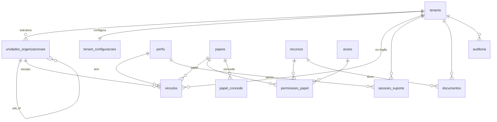

# Modelo de dados

## Fase 1 (implantada)

| Tabela | Chave | Conteúdo |
|---|---|---|
| `tenants` | id | órgão: nome oficial e curto, CNPJ, endereço, brasão (`logo_path`), domínios de e-mail, ativo |
| `unidades_organizacionais` | id | árvore: `tipo`, nome, sigla, `pai_id`, `caminho` (raiz→unidade), ativo |
| `perfis` | id = auth.users.id | nome, e-mail, telefone, foto, `is_platform_admin`, ativo, último acesso |
| `vinculos` | id | pessoa × órgão × unidade (escopo) × papel, ativo, padrão |
| `papeis`, `recursos`, `acoes` | código | catálogos da matriz |
| `permissoes_papel` | papel+recurso+ação | matriz |
| `papel_concede` | concedente+concedido | quem concede o quê |
| `sessoes_suporte` | id | admin da plataforma × órgão, motivo, prazo |
| `tenant_configuracoes` | tenant_id | cabeçalho e rodapé dos documentos, alertas, limite de anexo, textos |
| `configuracoes_globais` | chave | parâmetros da plataforma |
| `documentos` | id | metadados dos arquivos, dono (recurso + registro), exclusão lógica |
| `auditoria` | id | trilha imutável |

Convenções:
- Datas e horas em `timestamptz`, exibidas no horário de Brasília. Datas de calendário em `date`, sem conversão de fuso.
- Valores monetários (a partir da Fase 2) em `numeric(16,2)` no banco e centavos inteiros no app.
- Nada de listas separadas por vírgula: relações N:N têm tabela associativa.
- Unicidade composta com o órgão, como `(tenant_id, número do contrato)`.

## Próximas fases (planejado)

Fornecedores, servidores, unidades atendidas e grupos de rateio, classificação orçamentária, contratos com designações, dotação N:N, aditivos e documentos, empenhos e reforços, notas fiscais com referências, rateio, atesto e pagamentos, registros mensais de frequência e documentos emitidos com snapshot. Todas com `tenant_id`, RLS por `pode()`, auditoria e exclusão lógica.

## Fases 3 e 4 (implantadas)

| Tabela | Conteúdo |
|---|---|
| `modalidades_contratacao` | catálogo global (Lei 14.133) com a explicação de cada tipo |
| `contratos` | número (único no órgão), modalidade, fornecedor, unidade responsável, objeto, vigência, valor global, origem (renovação) |
| `contrato_designacoes` | gestor, fiscal e suplente (servidor, início, fim, portaria); a designação vigente dá acesso ao contrato |
| `contrato_dotacoes` | N:N entre o contrato e as dotações da classificação orçamentária |
| `contrato_aditivos` | prazo/valor/supressão; RASCUNHO → APROVADO/REJEITADO; o valor original não muda |
| `empenhos` | número/ano, tipo, valor, **dotação efetivamente usada** (precisa estar no contrato) |
| `empenho_reforcos`, `empenho_unidades` | reforços (com cancelamento) e unidades atendidas |
| `notas_fiscais` | empenho, número/série, emissão, valor, período, status de atesto e de pagamento, exceção de saldo, cancelamento |
| `nota_referencias`, `nota_unidades` | meses de referência e unidades atendidas (com rateio opcional que fecha com o valor) |
| `nota_atestos`, `nota_pagamentos` | atesto por designação (texto e nome de quem atestou) e pagamentos parciais |
| `documentos_emitidos` | extratos e atestos com o retrato dos dados na emissão (imutável) |

Visões com os cálculos (`v_contratos`, `v_empenhos`, `v_notas`, `v_contrato_dotacoes`, `v_nota_unidades`):
- filtram explicitamente cada linha: aparece para quem tem escopo pela matriz **ou** está designado no contrato;
- fazem as somas sem depender do que mais a pessoa enxerga.

Regras financeiras:
- `valor atual = valor global + aditivos aprovados`;
- `saldo do empenho = valor + reforços − notas não canceladas`;
- `saldo do contrato = valor atual − notas não canceladas`;
- empenhado, consumido e pago são exibidos lado a lado e nunca somados entre si.

## Fases 5 e 7 (implantadas)

| Tabela | Conteúdo |
|---|---|
| `ordens_servico` | número NNNN/ANO (gerado por gatilho com trava), contrato, fornecedor, descrição, status ABERTA → CONCLUÍDA/CANCELADA (cancelamento exige motivo; encerrada não muda mais) |
| `os_unidades` | unidades atendidas por ordem de serviço |

Funções (RPC), todas restritas ao escopo de quem chama:
- `relatorio_notas(p)` e `relatorio_notas_totais(p)`: filtros em jsonb (E entre campos, OU dentro do campo), ano pelo empenho ou pela emissão, totais por ano;
- `relatorio_consumo(p)`: métrica NOTAS, PAGO ou EMPENHADO, detalhada por SUBELEMENTO ou FONTE;
- `anos_com_movimento`, `painel(p_tenant, p_ano)` e `minhas_notificacoes(p_tenant)`;
- `importar_fornecedores`, `importar_servidores` e `importar_unidades_atendidas` com `p_aplicar = false` para prévia; gravam tudo ou nada;
- `registrar_exportacao`: registra na auditoria (ação EXPORTACAO) cada PDF ou Excel gerado.

A visão interna `classificacao_detalhada` não é exposta na API.

## Fases 6 e 8 (implantadas)

| Tabela | Conteúdo |
|---|---|
| `frequencias_mensais` | atrasos, faltas, justificativa e observação manual por servidor e mês (único por servidor/ano/mês); guarda a lotação do lançamento; escrita só pela função `salvar_frequencias` |
| `documentos_emitidos` | novos tipos `CONSOLIDADO_MENSAL` (com `referencia` = ano×100+mês) e `CHECKLIST_NOTA`, sempre com o retrato dos dados |
| `erros_aplicativo` | erros do navegador (mensagem, pilha, página, versão), lidos só pela plataforma; gravação limitada a 30 por pessoa a cada 10 min |

Funções:
- `consolidado_mensal`: servidores ativos em algum dia do mês, na unidade e abaixo dela;
- `salvar_frequencias`, `emitir_consolidado` e `emitir_checklist_nota`;
- `exportar_backup_orgao`: JSON do órgão, só Master, registrado na auditoria;
- `registrar_erro_aplicativo`;
- `observacao_frequencia`: a regra das observações, espelhada em `src/lib/frequencia.ts`.

Desempenho:
- `unidades_acessiveis(recurso, ação)`, `orgaos_permitidos` e `contratos_designados` calculam uma vez por consulta o que a pessoa alcança;
- as visões, os relatórios, o painel, as notificações, a busca de servidores, o consolidado e a auditoria filtram por esses conjuntos (junção hash), em vez de chamar `pode()` por linha.

## Catálogo orçamentário do município (ente)

| Tabela | Conteúdo |
|---|---|
| `entes` | município (ex.: Município de Aracaju); dono do catálogo orçamentário |
| `tenants.ente_id` | órgão → ente; só a plataforma liga ou troca |
| `classificadores` | códigos por ente (UO, função, subfunção, programa, ação, categoria, GND, modalidade, elemento, subelemento, fonte, detalhamento, subfonte, CO, IdUso, IDoc, resultado primário) |
| `classificacoes_orcamentarias` | dotação do ente: combinação desses códigos; `codigo_completo` no formato da nota de empenho (`18401 | 10.301.0085.2090 | 33903914 | Fonte 27490000`) |
| `unidade_orcamentaria_orgaos` | órgãos que usam cada UO; sem linha = todos os órgãos do ente |

Regras:
- Leitura por qualquer membro de um órgão do ente, porque o orçamento é público.
- Escrita só pela plataforma (RLS).
- O contrato só recebe dotação ativa e disponível para o órgão (`dotacao_disponivel`).

Funções:
- `cadastrar_dotacao(p)`:
  - recebe código e descrição de cada linha da nota de empenho;
  - desmembra a natureza de 8 dígitos;
  - reaproveita os códigos existentes e não duplica a dotação.
- `importar_dotacoes`: importa a LOA em lote, com prévia, tudo ou nada.
- `dotacoes_do_orgao` e `buscar_classificadores`: consulta pelos órgãos.

## CONECTA – Comunicação institucional (implantado)

| Tabela | Conteúdo |
|---|---|
| `notificacoes` | central de notificações internas (CONECTA e Patrimônio), por pessoa e órgão; gravadas só por funções, lidas só pela própria pessoa |
| `conecta_categorias` | categorias do órgão (ícone, cor, ordem), administráveis |
| `conecta_publicacoes` | publicação com retrato do autor (servidor, lotação, cargo), destaque com prazo, ocultação pela moderação e exclusão lógica |
| `conecta_destinatarios` | todos ou unidades (Secretaria, Diretoria, Coordenação, Setor, Unidade de saúde) e pessoas; unidade alcança quem está nela e abaixo dela |
| `conecta_versoes` | versões anteriores de título e texto (histórico das edições) |
| `conecta_comentarios`, `conecta_curtidas`, `conecta_anexos`, `conecta_denuncias` | interações; anexos em `<tenant>/conecta/<id>` com a visibilidade da publicação |

A visibilidade é decidida no banco (`conecta_pode_ver`, `conecta_visiveis`); o mural (`conecta_feed`) e o painel lateral só devolvem o que a pessoa pode ver.

## Gestão patrimonial (implantado)

| Tabela | Conteúdo |
|---|---|
| `patrimonio_categorias` | categorias e subcategorias (dois níveis), administráveis |
| `patrimonio_bens` | bem: número único no órgão, identificação, setor responsável (estrutura), unidade de saúde (unidades atendidas), sala, responsável (servidores), conservação, situação, trava de movimentação |
| `patrimonio_responsabilidades` | cada período de guarda e de localização do bem |
| `patrimonio_movimentacoes`, `patrimonio_mov_itens` | número NNNN/ANO, tipo, origem e destino por item, confirmações (digital, termo físico, administrativa), rejeição, cancelamento, retificação |
| `patrimonio_inventarios`, `patrimonio_inventario_itens` | conferência física com avaliação, divergências e bens sem cadastro |
| `patrimonio_relatorios` | relatórios emitidos: `RELATORIO DE PATRIMONIO - ANO AAAA[ - NNN].pdf`, filtros, quem emitiu; o PDF fica em `documentos` |

Localização, responsável e situação do bem só mudam por `patrimonio_movimentar` e pelas confirmações; a edição direta cobre só dados descritivos e avaliação (privilégio por coluna).
