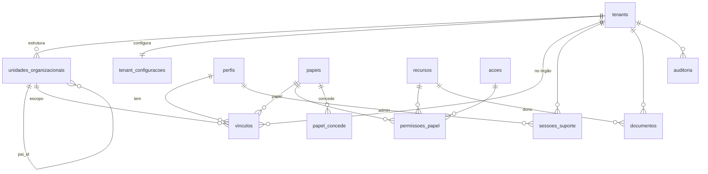

# Modelo de dados

## Fase 1 (implantada)

| Tabela | Chave | Conteúdo |
|---|---|---|
| `tenants` | id | órgão: nome oficial e curto, CNPJ, endereço, brasão (`logo_path`), domínios de e-mail, ativo |
| `unidades_organizacionais` | id | árvore: `tipo`, nome, sigla, `pai_id`, `caminho` (raiz→unidade), ativo |
| `perfis` | id = auth.users.id | nome, e-mail, telefone, foto, `is_platform_admin`, ativo, último acesso |
| `vinculos` | id | pessoa × órgão × unidade (escopo) × papel, ativo, padrão |
| `papeis`, `recursos`, `acoes` | código | catálogos da matriz |
| `permissoes_papel` | papel+recurso+ação | matriz |
| `papel_concede` | concedente+concedido | quem concede o quê |
| `sessoes_suporte` | id | admin da plataforma × órgão, motivo, prazo |
| `tenant_configuracoes` | tenant_id | cabeçalho e rodapé dos documentos, alertas, limite de anexo, textos |
| `configuracoes_globais` | chave | parâmetros da plataforma |
| `documentos` | id | metadados dos arquivos, dono (recurso + registro), exclusão lógica |
| `auditoria` | id | trilha imutável |

Convenções:
- Datas e horas em `timestamptz`, exibidas no horário de Brasília. Datas de calendário em `date`, sem conversão de fuso.
- Valores monetários (a partir da Fase 2) em `numeric(16,2)` no banco e centavos inteiros no app.
- Nada de listas separadas por vírgula: relações N:N têm tabela associativa.
- Unicidade composta com o órgão, como `(tenant_id, número do contrato)`.

## Próximas fases (planejado)

Fornecedores, servidores, unidades atendidas e grupos de rateio, classificação orçamentária, contratos com designações, dotação N:N, aditivos e documentos, empenhos e reforços, notas fiscais com referências, rateio, atesto e pagamentos, registros mensais de frequência e documentos emitidos com snapshot. Todas com `tenant_id`, RLS por `pode()`, auditoria e exclusão lógica.
